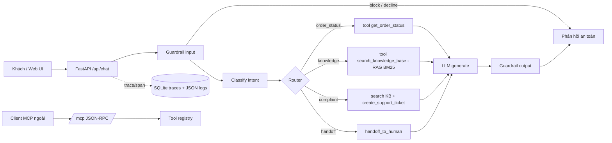

# OmniCare — AI Agent chăm sóc khách hàng (MVP)

MVP lấy cảm hứng từ kiến trúc [TGO](https://github.com/tgoai/tgo), rút gọn thành **một service Python** để dễ chạy, đọc và mở rộng.
Bao gồm đầy đủ 6 thành phần: **Model · Workflow agent · Tool layer (RAG + MCP) · Observability · Evals · Guardrails**.

## Chạy nhanh

```bash
cd omnicare
pip install -r requirements.txt
uvicorn app.main:app --reload          # mở http://localhost:8000
python -m evals.run_evals              # chạy bộ đánh giá
pytest -q                              # unit test
```

Mặc định `LLM_PROVIDER=mock` (chạy offline, không cần API key). Để dùng model thật, copy `.env.example` → `.env`:

```env
LLM_PROVIDER=openai          # hoặc ollama
LLM_BASE_URL=https://api.openai.com/v1
LLM_API_KEY=sk-...
LLM_MODEL=gpt-4o-mini
```

## Kiến trúc



| Thành phần | File | Ghi chú |
|---|---|---|
| Model | `app/llm.py` | Interface `LLM`; `OpenAICompatibleLLM` (OpenAI/Groq/OpenRouter/Ollama/vLLM), `MockLLM` offline. Lỗi model → tự degrade về trích xuất từ ngữ cảnh (flag `llm_fallback`). |
| Workflow agent | `app/agent.py` | Đồ thị: guardrail → intent (rule + LLM) → router → tool → generate → guardrail. Có memory phiên, hỏi lại mã đơn (multi-turn). |
| Tool layer | `app/tools.py`, `app/rag.py` | 4 tool kiểu MCP có JSON Schema + validate. RAG BM25 thuần Python, chunk theo heading Markdown, có ngưỡng điểm để từ chối khi không có căn cứ. Endpoint `POST /mcp` (`initialize`, `tools/list`, `tools/call`). |
| Observability | `app/observability.py` | Trace/span cho mỗi bước, log JSON, lưu SQLite. API `/api/traces`, `/api/metrics` (p50/p95, tokens, tỉ lệ handoff/blocked, flags, feedback 👍/👎). UI tab Traces/Metrics. |
| Evals | `evals/` | 24 case: knowledge, no-answer, order, multi-turn, complaint, handoff, injection, off-topic, PII. Đo intent/status/tool/retrieval/answer/safety + latency; `--threshold` để làm cổng CI. |
| Guardrails | `app/guardrails.py` | Input: độ dài, prompt injection (EN+VI), off-topic, ngôn từ xúc phạm → chuyển người, che PII (SĐT, email, CCCD, thẻ Luhn) **trước khi** vào LLM/trace. Output: rò rỉ system prompt, cam kết vượt chính sách, che PII, kiểm tra số liệu không có căn cứ. |

## API

| Method | Path | Mô tả |
|---|---|---|
| POST | `/api/chat` | `{message, session_id?}` → answer, intent, status, citations, tool_calls, guardrail_flags, trace_id |
| POST | `/api/feedback` | `{trace_id, score: -1/1}` |
| GET | `/api/traces`, `/api/traces/{id}` | Xem trace và span |
| GET | `/api/metrics` | Chỉ số tổng hợp |
| POST | `/mcp` | MCP JSON-RPC cho tool |
| POST | `/api/kb/reload` | Nạp lại kho tri thức sau khi sửa `data/kb/*.md` |

## Hạn chế của MVP & hướng mở rộng (theo TGO)
- Router dựa trên luật + LLM; có thể thay bằng ReAct/function-calling hoặc engine DAG như `tgo-workflow`.
- BM25 → vector search (pgvector) + rerank như `tgo-rag`.
- Session/ticket lưu trong RAM → Postgres/Redis.
- Observability → xuất OpenTelemetry sang Langfuse/Jaeger/Grafana.
- Evals hiện dựa trên từ khóa → thêm LLM-as-judge cho faithfulness/helpfulness khi dùng model thật.
- Kênh: thêm widget nhúng, Zalo/Facebook/Telegram như `tgo-platform`; thêm xác thực (auth) và rate-limit trước khi lên production.
