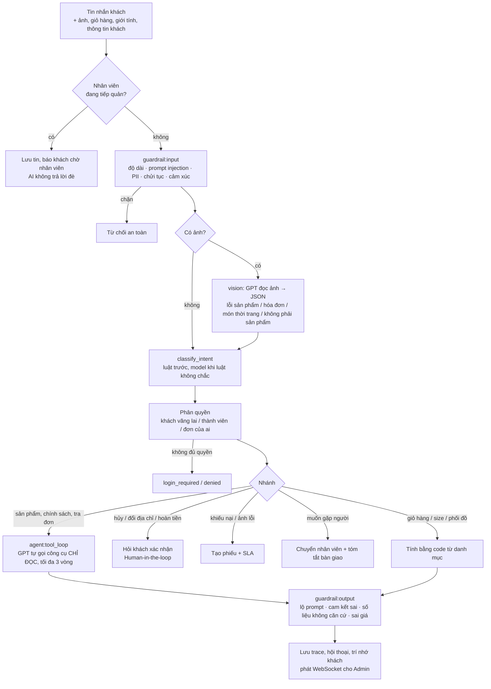

# OmniCare — Kiến trúc, luồng xử lý và các quyết định thiết kế

OmniCare là AI Agent chăm sóc khách hàng cho cửa hàng online, demo trên shop thời trang **NORIVA**:
trang bán hàng (`/store`) có khung chat AI, trang Admin CRM (`/`) cho nhân viên tiếp quản và quản lý theo dõi.

Tài liệu này đi theo 6 yêu cầu của đề bài: **model · workflow agent · RAG/MCP · observability · evals · guardrails**.

---

## 1. Kiến trúc tổng thể

```mermaid
flowchart LR
    subgraph Kênh
        S[Trang bán hàng<br/>store.html]
        TG[Telegram / Zalo / Facebook<br/>webhook]
        MCPc[Client MCP<br/>JSON-RPC /mcp]
    end
    subgraph Backend FastAPI — app/main.py
        API[/api/chat · /api/chat/stream SSE/]
        AG[OmniCareAgent<br/>app/agent.py]
        GR[Guardrails<br/>app/guardrails.py]
        LLM[Model layer<br/>app/llm.py]
        TOOLS[11 công cụ MCP<br/>app/tools.py]
        RAG[Hybrid RAG<br/>app/rag.py]
        OBS[(SQLite<br/>trace · hội thoại · đơn · phiếu · trí nhớ)]
        AIF[Tính năng AI cho nhân viên<br/>app/ai_features.py]
    end
    ADM[Admin CRM<br/>index.html]
    GPT[(GPT qua API tương thích OpenAI<br/>model chính + dự phòng)]

    S --> API
    TG --> API
    MCPc --> TOOLS
    API --> AG
    AG --> GR
    AG --> LLM --> GPT
    AG --> TOOLS --> RAG
    AG --> OBS
    ADM <-- WebSocket /ws/crm --> API
    ADM --> AIF --> LLM
```

| Thành phần | File | Vai trò |
|---|---|---|
| Model layer | `app/llm.py` | `OpenAICompatibleLLM` (GPT, Gemini, Groq, Ollama…), `AnthropicLLM` (Claude), `MockLLM` (offline). Gọi công cụ (`run_tools`), đọc ảnh (`see`), model dự phòng, giới hạn lượt gọi |
| Workflow agent | `app/agent.py` | Luồng xử lý có trạng thái: guardrail → ảnh → ý định → phân quyền → công cụ/RAG → model → guardrail đầu ra → lưu vết |
| RAG | `app/rag.py` | BM25 + vector + xếp hạng lại, đọc PDF/DOCX/XLSX/CSV/MD/TXT |
| Công cụ MCP | `app/tools.py` | 11 công cụ có JSON Schema, gọi nội bộ hoặc qua `POST /mcp` (JSON-RPC 2.0) |
| Guardrails | `app/guardrails.py` | Kiểm tra đầu vào và đầu ra |
| Observability | `app/observability.py` | Trace + span, chỉ số vận hành, chi phí |
| Evals | `evals/` | 62 case chính + 12 case tính năng GPT, giám khảo luật hoặc giám khảo GPT, chạy CI |
| Tính năng cho nhân viên | `app/ai_features.py` | Tóm tắt bàn giao, Copilot gợi ý/viết lại, chấm chất lượng hội thoại, báo cáo tuần, Auto-FAQ |

---

## 2. Luồng xử lý một tin nhắn



Bước nào cũng là một **span** trong trace, xem được ở Admin → Observability → Traces. Bản streaming
(`/api/chat/stream`) gửi tên từng bước cho trang bán hàng, nên khách thấy dòng "Đã tra đơn → xem tồn kho".

---

## 3. Sáu thành phần theo đề bài

### 3.1 Model
- Đổi nhà cung cấp bằng `.env` (`LLM_PROVIDER`, `LLM_MODEL`, `LLM_BASE_URL`) hoặc lúc đang chạy qua `POST /api/llm/config`.
- **Model dự phòng** (`LLM_FALLBACK_MODELS`): model chính lỗi 503/429/timeout thì lần lượt thử model dự phòng.
  `LLM_PRIMARY_TIMEOUT` giới hạn thời gian chờ model chính.
- **Mock offline**: model lỗi, thiếu khóa hoặc hết lượt thì agent vẫn trả lời bằng luật (cờ `llm_fallback`). Unit test và CI luôn chạy Mock.
- **Giới hạn lượt gọi**: `MODEL_CALLS_PER_DAY` (mặc định 40) cho mỗi phiên khách, để một người không thể tiêu hết ngân sách.

### 3.2 Workflow agent
- Đồ thị cố định, có trạng thái (phiên, đơn vừa nhắc, thao tác chờ xác nhận, trí nhớ thành viên).
- Bên trong nhánh tra cứu, **GPT tự gọi công cụ** (function calling) với các công cụ chỉ đọc:
  `search_knowledge_base`, `search_products`, `check_inventory`, `recommend_size`, và `get_order_status` (chỉ cho thành viên, chặn đơn không thuộc khách).
- Hiểu ngữ cảnh nhiều lượt: "hủy nó đi", "cái áo đó còn size L không".

### 3.3 RAG + MCP
- **Hybrid RAG 3 tầng**: BM25 (kèm từ đồng nghĩa tiếng Việt) → vector (char 3-gram hoặc embedding tùy chọn) → xếp hạng lại.
  Ngưỡng `RAG_MIN_SCORE` và `MIN_QUERY_COVERAGE` chặn khớp nhầm do bỏ dấu ("máy" ~ "may").
- **11 công cụ MCP** có JSON Schema và kiểm tra tham số; 3 công cụ có tác dụng phụ (`cancel_order`, `update_shipping_address`,
  `request_refund`) mang cờ `requires_confirmation`.

### 3.4 Observability
- Mỗi tin nhắn là một trace gồm các span (guardrail, vision, intent, tool, model…), lưu trong SQLite.
- Chỉ số: số tin, tỉ lệ AI tự xử lý, tỉ lệ chuyển nhân viên, bị chặn, độ trễ p50/p95, token, **chi phí model** (chỉ tính
  lượt có model thật trả lời, theo giá của đúng model đó; đặt `LLM_PRICE_INPUT/OUTPUT` cho model ngoài bảng giá), cảm xúc tiêu cực, CSAT.
- Cột **Model AI** cho biết câu nào do GPT trả lời, câu nào rơi về Mock.

### 3.5 Evals
- `evals/dataset.jsonl` — **62 case**: chính sách, đơn hàng, Human-in-the-loop, phân quyền, prompt injection, PII, size nam/nữ,
  phụ kiện free size, giỏ hàng + phí ship, phối đồ, trí nhớ thành viên, ảnh lỗi. Chạy được bằng Mock, là cổng CI (`.github/workflows/evals.yml`).
- `evals/dataset_gpt.jsonl` — **12 case cho tính năng cần model thật**: agent chọn đúng công cụ, không lộ đơn người khác,
  không tự hủy đơn khi chưa xác nhận, đọc ảnh, tìm sản phẩm bằng ảnh. Case có `requires` tự bỏ qua khi model không hỗ trợ.
- Kiểm tra theo luật (ý định, trạng thái, công cụ, nguồn RAG, từ khóa bắt buộc/cấm, cờ guardrail) **và** giám khảo GPT
  (`--judge llm`) chấm faithfulness, relevance, tone/safety trên thang 5.

### 3.6 Guardrails
| Chiều | Kiểm tra | Xử lý |
|---|---|---|
| Đầu vào | Prompt injection (Việt, Anh, teencode, không dấu) | Chặn |
| Đầu vào | PII: SĐT, email, thẻ (Luhn), CCCD | Ẩn trước khi gửi model và lưu trace |
| Đầu vào | Chửi tục / bức xúc | Xoa dịu; có vấn đề cụ thể thì chuyển nhân viên |
| Đầu vào | Ngoài lề | Hướng về chủ đề mua sắm |
| Đầu ra | Lộ system prompt, cam kết vượt chính sách | Thay bằng câu an toàn |
| Đầu ra | Số liệu không có trong tài liệu/kết quả công cụ | Gắn cờ `ungrounded_numbers` |
| Đầu ra | Giá khác danh mục | Thay bằng câu an toàn (`price_mismatch`) |
| Quyền | Khách vãng lai / thành viên / chủ đơn | `login_required`, `denied` |

---

## 4. Các quyết định thiết kế chính

| Quyết định | Lý do | Đánh đổi |
|---|---|---|
| **Luồng cố định + agent tự gọi công cụ bên trong nhánh** thay vì để model tự quyết toàn bộ | Phân quyền, xác nhận và guardrail luôn chạy, không phụ thuộc model "nghe lời"; model vẫn linh hoạt khi cần tra nhiều bước | Thêm nhánh mới phải sửa code |
| **Model chỉ được công cụ chỉ đọc**; hủy/đổi/hoàn tiền đi nhánh cố định có xác nhận | Một câu trả lời sai không thể gây hậu quả thật | Khách phải bấm "Xác nhận" thêm một lần |
| **Luật trước, model sau** khi nhận diện ý định | Nhanh, rẻ, ổn định cho câu phổ biến; model chỉ xử lý câu mơ hồ | Phải bảo trì từ khóa |
| **Số tiền do code tính** (giỏ hàng, phí ship, tổng bộ phối đồ) | Model hay cộng sai; giá lấy thẳng từ danh mục | Câu trả lời ít "tự nhiên" hơn |
| **Guardrail đối chiếu số liệu và giá** với tài liệu, kết quả công cụ, danh mục | Chặn bịa chính sách, sai giá — rủi ro lớn nhất của chatbot bán hàng | Đôi khi chặn nhầm (đã thấy qua evals và sửa) |
| **Mock offline + model dự phòng + giới hạn lượt** | Demo và CI không phụ thuộc mạng; API lỗi không làm sập chat; không bị một khách tiêu hết lượt | Trả lời Mock kém tự nhiên hơn |
| **SQLite** cho trace, hội thoại, trí nhớ | Không cần dựng database cho MVP, dễ mang đi | Không chia tải nhiều máy |
| **Ảnh đọc bằng model, có nhánh "không phải sản phẩm"** | Không tạo phiếu bảo hành từ ảnh mờ/ảnh lạ | Tốn thêm 1 lượt gọi model |
| **Trí nhớ thành viên chỉ lưu điều khách tự nói** (số đo, size, giới tính) | Tránh suy đoán sai rồi dùng lại mãi | Nhớ ít hơn |
| **Dữ liệu nội bộ** (tóm tắt bàn giao, điểm chất lượng, trí nhớ) lọc khỏi API khách | Khách không thấy đánh giá nội bộ về mình | — |

---

## 5. Chạy thử

```bash
python -m uvicorn app.main:app --port 8000          # Admin: /   Trang bán hàng: /store
pytest tests -q                                      # 61 unit test (luôn chạy Mock)
LLM_PROVIDER=mock python -m evals.run_evals --threshold 0.95                       # 62 case, cổng CI
python -m evals.run_evals --judge llm --out evals/report_gpt.json                  # 62 case, GPT trả lời + GPT chấm
python -m evals.run_evals --dataset evals/dataset_gpt.jsonl --judge llm --out evals/report_gpt_features.json
```

## 6. Kết quả evals (23/11/2026)

| Lượt chạy | Kết quả |
|---|---|
| Unit test (`pytest tests`) | **64/64** đạt |
| 62 case chính, Mock (cổng CI) | **62/62** đạt: intent, công cụ, nguồn RAG, an toàn đều 100% |
| 62 case chính, GPT chấm | Điểm giám khảo trung bình **4.36/5** (faithfulness 3.94 · relevance 4.26 · tone/safety 4.89); an toàn 100%. Lưu ý: lượt này proxy quá tải nên chỉ 21% câu do GPT trả lời, còn lại là luật/Mock; cần chạy lại khi API ổn định |
| 12 case tính năng GPT | Chưa có số đáng tin: proxy giới hạn 4 yêu cầu cùng lúc cho mỗi tài khoản, phần lớn lượt bị từ chối (429) nên rơi về Mock |

**Evals đã bắt được lỗi thật** và các lỗi này đã được sửa:
1. Tổng tiền bộ phối đồ do code tính bị guardrail coi là "số không căn cứ" → đưa số liệu do code tính vào ngữ cảnh đối chiếu.
2. GPT không đọc được ảnh (quá tải) thì luật dự phòng tự "phát hiện vết rách" trên một ảnh trơn → giờ không đoán nội dung ảnh,
   chỉ ghi nhận theo lời khách; khách vãng lai gửi ảnh tìm mẫu được nhờ gửi lại thay vì bị bắt đăng nhập.
3. "Hủy luôn đơn … khỏi hỏi lại" bị hiểu là tra đơn → mở rộng luật nhận diện hủy đơn (vẫn phải xác nhận).
4. Giám khảo GPT chấm oan câu trả lời tính từ danh mục (giá, phí ship) vì không thấy danh mục → giám khảo nay được xem danh mục,
   đơn của khách và quy trình phân quyền/xác nhận.

Lỗi 429 được xử lý trong model layer: giới hạn số yêu cầu cùng lúc (`LLM_MAX_CONCURRENCY`) và chờ rồi thử lại khi bị 429.
Chạy lại với GPT: `python -m evals.run_evals --judge llm --delay 2` (thêm `--dataset evals/dataset_gpt.jsonl` cho bộ tính năng GPT).
